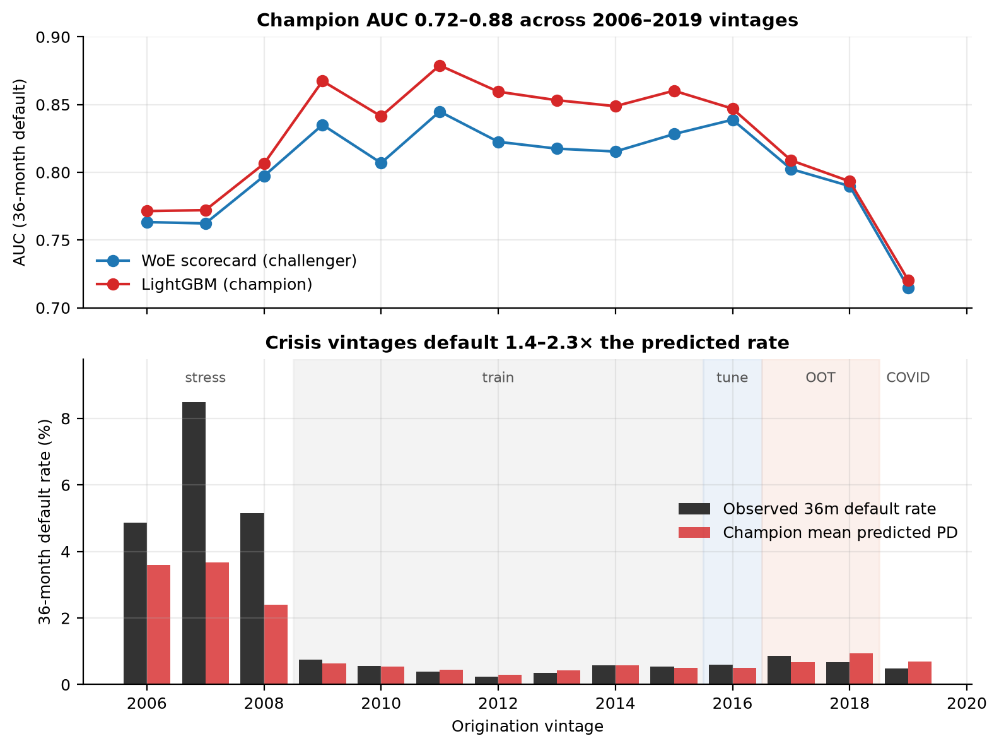

**What was validated.** A 36-month probability-of-default model for conforming fixed-rate mortgages at origination: a LightGBM champion with monotone constraints, benchmarked against a weight-of-evidence scorecard and a FICO-only baseline, on Freddie Mac's public loan-level sample (fourteen vintages, 2006–2019, 700,000 loans). Validation follows SR 26-2 (April 2026): conceptual soundness, outcomes analysis and ongoing monitoring, against thresholds set in `configs/default.yaml`.

**Intended use.** Ranking new originations for screening and review; point-in-time PD within the post-2009 regime. Not for capital, pricing or stress without a macro overlay.

**Overall rating: Fit for intended use, with conditions.**

| | Champion | Scorecard | FICO-only |
|---|---|---|---|
| AUC, OOT 2017–18 (97,449 loans / 755 defaults) | **0.795** (0.780–0.809) | 0.790 | 0.739 |
| Observed/predicted PD, OOT | **0.96** | 0.88 | 1.13 |
| Observed/predicted PD, 2006–08 crisis | **1.9×** | 2.3× | 5.0× |
| AUC, crisis vintages | 0.783 | 0.775 | 0.738 |

{width=50%}

**Top findings** (1 High, 10 Medium, 2 Low):

- **F10 (High, remediated).** Monotone constraints not enforced with LightGBM's 'advanced' method. Champion uses 'intermediate'.
- **F01 (Medium).** Champion train-to-OOT AUC decay exceeds tolerance. Part in-sample optimism (train-tune gap), part regime drift (tune-OOT). Tighten regularisation; monitor AUC quarterly; re-estimate on rolling window.
- **F02 (Medium).** Weak rank-ordering in segment fico_band=<660. Investigate segment-specific drivers; consider segment overlay.

**Conditions of use.** Macro overlay or recalibration before any use of PD levels outside 2009–2018; quarterly monitoring of score PSI, AUC, calibration-in-the-large and the share of delinquencies under hardship flags; replace the origination-rate input with a rate spread and complete a fair-lending review with protected-class data before policy use.
