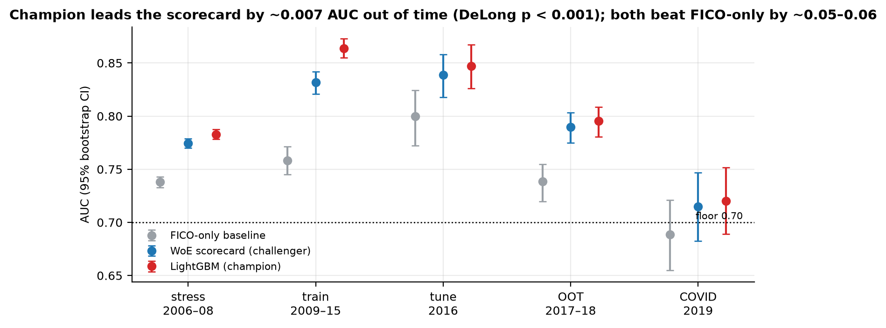
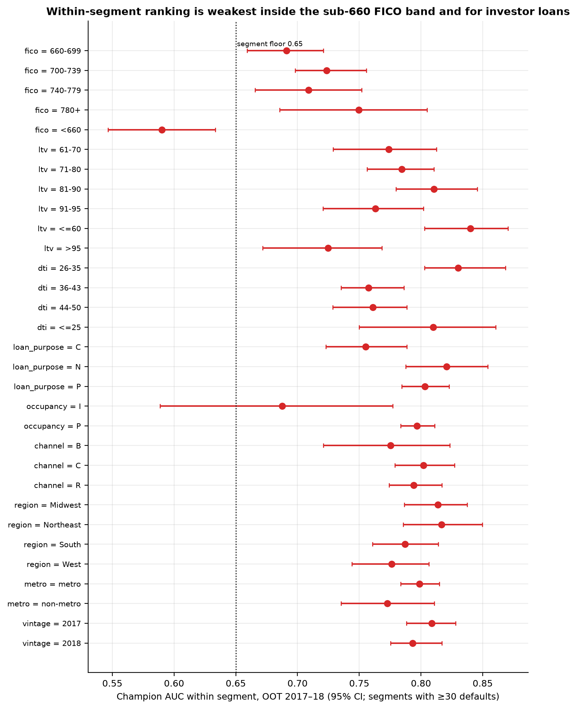
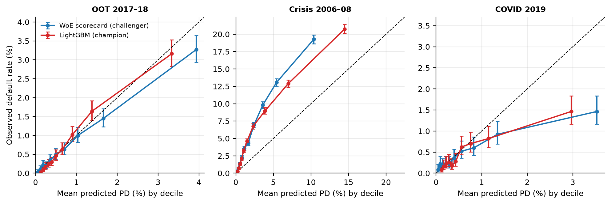
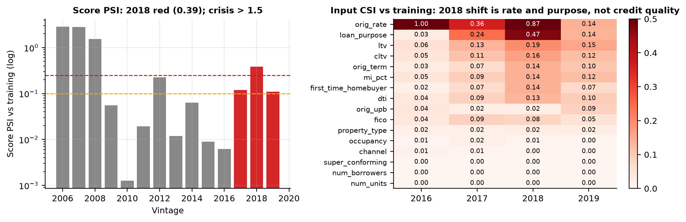
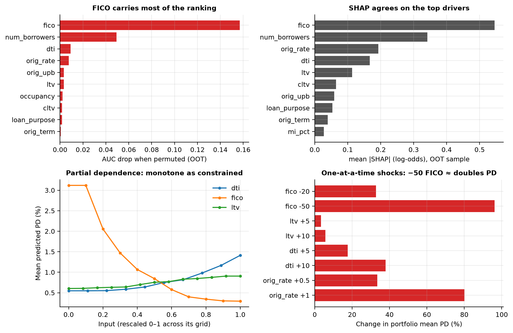

# Executive summary {-}

**Model.** A 36-month probability-of-default (PD) model for conforming, fixed-rate, full-documentation mortgages at origination, built on Freddie Mac's public single-family loan-level *sample* dataset (50,000 loans per vintage). It uses sixteen borrower and loan attributes known at origination (§4); geography, seller and vintage are excluded by design. The champion is LightGBM with monotone constraints. The challenger is a weight-of-evidence logistic scorecard, and the baseline uses FICO alone.

**Intended use.** Ranking new originations for acquisition screening and risk-based review, and point-in-time PD within the post-2009 underwriting regime. Not for capital, stress testing or downturn pricing without a macro overlay.

**Overall rating: Fit for intended use, with conditions.**

- **Discrimination.** Champion AUC 0.795 (95% CI 0.780–0.809) on 97,449 loans / 755 defaults from the 2017–2018 vintages, against 0.790 for the scorecard and 0.739 for FICO alone. The champion's edge over the scorecard is small but significant (ΔAUC +0.005, DeLong p = 0.008). The riskiest decile captures 41% of OOT defaults.
- **Calibration.** Pooled OOT observed/predicted is 0.96; by vintage 2017 1.31, 2018 0.72. On the 2006, 2007, 2008 crisis vintages the model still ranks (AUC 0.783) but predicts 3.2% against 6.2% observed, an under-prediction of 1.9×. The model has no macro inputs and saw no downturn in training.
- **Monotone constraints.** With LightGBM's `advanced` method, predictions move against the declared direction for ltv 11.2%, dti 4.5%, fico 1.5%, orig_rate 0.1% of loans (LightGBM issue #5358). The champion uses `intermediate`.
- **Target definition.** Without the hardship guard, 36-month default rates for 2017, 2018, 2019 are 3.31%, 4.61%, 4.88% instead of 0.91%, 0.70%, 0.48%.

**Findings.** 1 High (0 open), 10 Medium, 2 Low. The conditions on the rating are listed in Section 11. The main one is that PD levels are not used outside the 2009–2018 regime without a macro overlay.

{width=78%}

# Model overview, intended use and materiality

The model estimates the probability that a new loan becomes 90 or more days delinquent, or terminates through a credit event, within 36 months of its first payment. Every input is known at origination; no performance information is used. The population is fixed-rate, fully amortising, full-documentation conforming loans sold to Freddie Mac. HARP/Relief Refinance loans are excluded here, and government loans, ARMs and non-standard programs are not in Freddie's Standard dataset.

Under SR 26-2 the intensity of validation follows materiality, the product of model exposure and purpose. Here the model is treated as if it screened a conforming purchase book: material by exposure, moderate by purpose (screening and review, not capital). At that tier, independent validation with outcomes analysis, benchmarking and sensitivity testing is expected before use. The same person built and validated this model, so the review is not independent in SR 26-2's sense.

# Regulatory context

This validation follows the *Supervisory Guidance on Model Risk Management* issued jointly by the Federal Reserve, OCC and FDIC on April 17, 2026 (Federal Reserve SR 26-2; OCC Bulletin 2026-13). It supersedes SR 11-7 (2011) and SR 21-8 and rescinds OCC 2011-12. SR 26-2 names three components of validation (conceptual soundness, outcomes analysis and ongoing monitoring) and frames validation around effective challenge by objective experts with the standing to effect change. Sections 5–8 and 12 cover those components, and Appendix D maps this report to SR 26-2 and to the older SR 11-7 headings.

Footnote 3 of SR 26-2 excludes generative and agentic AI but applies the guidance to "traditional statistical and quantitative models and non-generative, non-agentic AI models", so a gradient-boosted PD model is in scope.

The discrimination and calibration tests follow the Basel Committee's *Studies on the Validation of Internal Rating Systems* (Working Paper 14, 2005). The PRA's SS1/23 Principle 4 serves as a second checklist of what a validation must cover. Fair-lending context comes from ECOA/Regulation B and CFPB Circular 2022-03.

# Data

**Source and lineage.** Freddie Mac Single-Family Loan-Level Dataset, Sample files, Release 47 (July 2026), downloaded from Clarity Data Intelligence on 2026-09-12. The SHA-256 of each vintage zip is recorded in `data/manifest.json`. Before any column is named, the file layout is checked against Freddie's July 2026 layout spreadsheet (31 origination fields, 35 performance fields). Fourteen vintages were ingested, 700,000 loans and 44,653,660 loan-months, with no orphan records between the origination and performance files. Performance runs through 202603.

**Target definition.** `default_36m = 1` if within months 1–36 after first payment the loan is ever 90+ days delinquent (Freddie delinquency status $\geq$ 03, or RA), or terminates through a third-party sale, short sale/charge-off or REO disposition (zero-balance codes 02/03/09). Loan age is computed from First Payment Date, not Freddie's Loan Age field, which resets on modification. A 90+ month does not count if the loan is in, or within 3 months after, a servicer-reported forbearance plan (Borrower Assistance Plan = F) or a disaster-related delinquency flag. Credit-event terminations always count. Loans are observable if they reach month 36 or pay off voluntarily before it; defects (ZB 96) and loans sold before month 36 without a default are excluded. The pure ever-90+ definition and the forbearance-only guard are kept as sensitivities.

Without the guard, 36-month default rates for the 2017, 2018, 2019 vintages are 3.31%, 4.61%, 4.88%; with it they are 0.91%, 0.70%, 0.48%, and the out-of-time vintages sit close to 2016's 0.65%. This is a data-relevance issue in SR 26-2's sense and is carried as a Medium finding. The target definition and the train/tune split were revised after the out-of-time default rates were first examined.

**Sample design.** Vintage is the sample file year, which is the origination year. About 17% of each file's loans have their first payment in the following calendar year.

| vintage | role | sample loans | observable | after HARP excl. | defaults | 36m rate |
|------|----------|--------|--------|----------|-------|-------|
| 2006 | stress | 50000 | 49773 | 49773 | 2417 | 4.86% |
| 2007 | stress | 50000 | 49484 | 49484 | 4205 | 8.50% |
| 2008 | stress | 50000 | 49620 | 49620 | 2553 | 5.15% |
| 2009 | train | 50000 | 49849 | 44518 | 336 | 0.75% |
| 2010 | train | 50000 | 49911 | 35315 | 197 | 0.56% |
| 2011 | train | 50000 | 49895 | 34462 | 135 | 0.39% |
| 2012 | train | 50000 | 49892 | 32526 | 74 | 0.23% |
| 2013 | train | 50000 | 49920 | 35552 | 123 | 0.35% |
| 2014 | train | 50000 | 49905 | 42623 | 243 | 0.57% |
| 2015 | train | 50000 | 49965 | 45952 | 251 | 0.55% |
| 2016 | tune | 50000 | 49934 | 47413 | 281 | 0.59% |
| 2017 | oot | 50000 | 49879 | 48077 | 419 | 0.87% |
| 2018 | oot | 50000 | 49883 | 49372 | 336 | 0.68% |
| 2019 | covid_exhibit | 50000 | 49877 | 49847 | 239 | 0.48% |

Train = 270,948 loans / 1,359 defaults; tune = 2016 (used only for early stopping and hyperparameter selection); OOT = 97,449 / 755; stress = 148,877 / 9,175. The 2019 vintage's window spans the pandemic, so it is shown as a monitoring exhibit rather than a test.

**Data quality.** FICO is missing on at most 0.1% of loans per vintage. DTI is missing on 2.1%–2.2% of 2006–2008 loans; from 2009 it is missing only on HARP loans. MSA is null on 9%–23% of loans (non-metro properties). HARP loans, 8%–35% of 2009–2015 originations, are excluded; this is the largest reduction in the waterfall and leaves 74–336 defaults per training vintage.

# Model development summary

| | Baseline | Challenger | Champion |
|---|---|---|---|
| Form | Logistic on Classic FICO (+ missing flag) | WoE scorecard: optbinning monotonic bins → L2 logistic | LightGBM, binary objective |
| Inputs | 1 | 16 | 16 |
| Constraints | None | Monotonic binning trend per input | `monotone_constraints` on FICO (−), LTV, CLTV, DTI, rate (+); method = intermediate |
| Selection | None | C = 1 | Random search, 24 configs; early stop on tune AUC; best: 63 leaves, min_child_samples 500, lr 0.03, L2 0.0, 67 trees |
| Class handling | None (no resampling or re-weighting; see §5) | None | None |

Inputs (information value from the scorecard binning, training sample): fico (0.94), orig_rate (0.42), num_borrowers (0.30), dti (0.27), ltv (0.17), cltv (0.16), orig_term (0.14), loan_purpose (0.07); the remaining inputs each have IV < 0.06.

Across all 24 configurations, tune AUC stays within 0.840–0.847 (search history in `outputs/model_card.json`), so the result does not depend on the hyperparameter draw.

# Conceptual soundness

**Variable rationale.** Each input has an economic rationale: FICO (borrower credit history, −), LTV/CLTV (equity cushion and incentive, +), DTI (payment capacity, +), origination rate (risk-based pricing, +), number of borrowers (income diversification, −), loan purpose (cash-out refinance is riskier than purchase), occupancy (investor/second-home), MI %, property type, channel, first-time-buyer flag, super-conforming flag, units, term and UPB. Geography (state, MSA, ZIP3), seller and servicer are left out of the model and used only for segmentation and the fairness proxy. Geography is a fair-lending risk, and seller/servicer identity is not a borrower attribute.

**Method choice.** A boosted-tree champion is justified only if it beats a well-built scorecard out of time and stays monotone where an underwriter would expect; §6 and §7 test both. Monotone constraints are needed because the model must be explained to borrowers (Reg B adverse-action reasons) and to examiners.

**No class-imbalance correction.** The default rate is about 1%. Resampling or re-weighting would inflate predicted probabilities and break calibration (van den Goorbergh et al., 2022), so all three models are trained on the natural default rate.

**Rate input.** Origination rate has IV 0.42 and ranks 4th by permutation importance. Its median moves between 3.75% and 4.88% across training vintages, so it partly encodes calendar time rather than the borrower's risk-based spread. At redevelopment it should be replaced by the spread to that month's PMMS 30-year rate.

**Monotone constraints.** The champion was refit with each LightGBM constraint method, keeping its hyperparameters, and each constrained input was moved across its grid for 5,000 OOT loans. The table gives the share of loans whose prediction moves against the declared direction.

| input | basic (%) | intermediate (%) | advanced (%) |
|---|---|---|---|
| dti | 0.0 | 0.0 | 4.5 |
| fico | 0.0 | 0.0 | 1.5 |
| ltv | 0.0 | 0.0 | 11.2 |
| orig_rate | 0.0 | 0.0 | 0.1 |

# Outcomes analysis

## Discrimination

| sample | n / defaults | baseline | challenger | champion |
|---|---|---|---|---|
| train 2009–15 | 270,948 / 1,359 | 0.758 (0.745–0.771) | 0.832 (0.821–0.842) | 0.864 (0.855–0.873) |
| tune 2016 | 47,413 / 281 | 0.800 (0.772–0.824) | 0.839 (0.818–0.858) | 0.847 (0.826–0.867) |
| OOT 2017–18 | 97,449 / 755 | 0.739 (0.720–0.755) | 0.790 (0.775–0.804) | 0.795 (0.780–0.809) |
| stress 2006–08 | 148,877 / 9,175 | 0.738 (0.733–0.743) | 0.775 (0.770–0.779) | 0.783 (0.778–0.787) |
| COVID 2019 | 49,847 / 239 | 0.689 (0.655–0.721) | 0.715 (0.682–0.747) | 0.720 (0.689–0.752) |

Out of time, the scorecard and the champion beat the FICO-only baseline by 0.051 and 0.057 AUC (DeLong p $\leq$ 8e-19). The champion's edge over the scorecard is small (+0.005, p = 0.008). The champion's AUC falls 0.068 from train to OOT (0.864 → 0.847 → 0.795), more than the 0.03 tolerance, and this is carried as a Medium finding. The train-to-tune step is in-sample optimism; the tune-to-OOT step is regime drift that all three models share.

{width=85%}

**Capture.** The champion's riskiest decile holds 41% of OOT defaults at a 3.2% observed rate (lift 4.1×); the top two deciles hold 62%.

**Segments (OOT, champion; segments with $\geq$ 100 defaults).** The weakest within-segment ranking is fico_band = <660 (AUC 0.590, 95% CI 0.546–0.633), then fico_band = 660-699 (0.691). The first is below the 0.65 segment floor and is carried as a finding. Appendix B has the full table.

{width=80%}

## Calibration

| sample | observed | predicted | obs/pred | intercept | slope | slope SE | Brier skill | ECE |
|---|---|---|---|---|---|---|---|---|
| train 2009–15 | 0.50% | 0.50% | 1.002 | 1.617 | 1.353 | 0.025 | 0.021 | 0.002 |
| tune 2016 | 0.59% | 0.49% | 1.201 | 2.075 | 1.400 | 0.065 | 0.013 | 0.003 |
| OOT 2017–18 | 0.77% | 0.80% | 0.963 | -0.180 | 0.970 | 0.035 | 0.010 | 0.001 |
| stress 2006–08 | 6.16% | 3.22% | 1.916 | 0.200 | 0.815 | 0.009 | 0.044 | 0.029 |
| COVID 2019 | 0.48% | 0.70% | 0.685 | -1.558 | 0.742 | 0.060 | -0.008 | 0.002 |

Pooled out of time, observed/predicted is 0.96 and the slope 0.97 ± 0.03. By vintage the ratio is 2017 1.31, 2018 0.72, so the pooled figure nets out errors in opposite directions. 3 of 10 OOT deciles have mean predicted PD outside the observed 95% Wilson interval. The slope is 1.35 on train and 1.40 on tune. Calibration-in-the-large is outside ±15% for tune 2016, stress 2006–08, COVID 2019. The 2019 COVID exhibit (observed/predicted 0.69) is not a valid calibration test, because forbearance, deferral and disaster relief suppressed defaults that the guarded target removes from the numerator.

{width=100%}

The inputs describe the borrower and say nothing about the economy. A 2006 borrower with a 720 FICO and 80 LTV gets the same PD as a 2014 borrower with the same attributes. Relative risk is stable, so ranking holds on the crisis vintages (AUC 0.783), but the PD level does not.

## Stability

| vintage | role | n | score PSI | AUC | observed | predicted |
|------|----------|------|-------|------|--------|--------|
| 2006 | stress | 49773 | 2.866 | 0.771 | 4.86% | 3.59% |
| 2007 | stress | 49484 | 2.801 | 0.772 | 8.50% | 3.67% |
| 2008 | stress | 49620 | 1.537 | 0.806 | 5.15% | 2.39% |
| 2009 | train | 44518 | 0.056 | 0.867 | 0.75% | 0.63% |
| 2010 | train | 35315 | 0.001 | 0.841 | 0.56% | 0.54% |
| 2011 | train | 34462 | 0.019 | 0.879 | 0.39% | 0.45% |
| 2012 | train | 32526 | 0.227 | 0.859 | 0.23% | 0.30% |
| 2013 | train | 35552 | 0.012 | 0.853 | 0.35% | 0.42% |
| 2014 | train | 42623 | 0.063 | 0.849 | 0.57% | 0.58% |
| 2015 | train | 45952 | 0.009 | 0.860 | 0.55% | 0.51% |
| 2016 | tune | 47413 | 0.006 | 0.847 | 0.59% | 0.49% |
| 2017 | oot | 48077 | 0.119 | 0.809 | 0.87% | 0.67% |
| 2018 | oot | 49372 | 0.385 | 0.793 | 0.68% | 0.94% |
| 2019 | covid_exhibit | 49847 | 0.109 | 0.720 | 0.48% | 0.70% |

Score PSI against the training distribution is green for training and tune vintages except 2012 amber (0.23). It is 0.12 for 2017 and 0.39 for 2018. The largest 2018 input shifts are orig_rate (CSI 0.87), loan_purpose (0.47) and ltv (0.19). Vintages over-predicted by more than 15%: 2012, 2013, 2018, 2019. The crisis vintages are far outside the development population (PSI above 0.25), as a stress test should be.

{width=100%}

# Sensitivity analysis

{width=100%}

FICO dominates (permutation AUC drop 0.157), followed by num_borrowers (0.049), dti (0.009) and orig_rate (0.008). SHAP gives the same top four. One-at-a-time shocks on the OOT book:

| input | shock | portfolio mean PD | change |
|---|---|---|---|
| (none) | +0 | 0.80% | +0% |
| fico | -20 | 1.07% | +33% |
| fico | -50 | 1.58% | +96% |
| ltv | +5 | 0.83% | +3% |
| ltv | +10 | 0.85% | +6% |
| dti | +5 | 0.95% | +18% |
| dti | +10 | 1.11% | +38% |
| orig_rate | +0.5 | 1.07% | +33% |
| orig_rate | +1 | 1.45% | +80% |

On the monotonicity grid test (5,000 OOT loans; FICO 620–820 by 20, LTV and DTI by 5, rate 2.5–7% by 0.5), the champion's maximum violation rate is 0.0%.

# Benchmarking and model recommendation

The champion's AUC lead over the scorecard ranges from +0.005 to +0.032 across samples. The scorecard is transparent (a fixed score per bin); the champion needs SHAP for reason codes. **Recommendation:** adopt the champion for ranking, keep the scorecard as the production challenger, and use the FICO-only model as the floor in monitoring. If the adverse-action process cannot use SHAP-based reasons, switching to the scorecard costs 0.005 AUC, which is small enough that transparency should win.

# Fairness / disparate-impact proxy analysis

Groups are tertiles of the non-white population share in the loan's metro area (ACS 2022 5-year, table B03002, CBSA or metropolitan division), with non-metro loans as a separate group; 90% of OOT loans matched an ACS geography. T1 (lowest share) is the reference. The illustrative policy cutoff declines the riskiest 10% of the OOT book (PD > 1.79%).

| proxy group | n | defaults | observed | predicted | pred/obs | AUC | pass rate | AIR | SMD |
|---|---|---|---|---|---|---|---|---|---|
| T1 | 29490 | 196 | 0.66% | 0.78% | 1.176 | 0.808 | 90.7% | 1.000 | 0.000 |
| T2 | 29091 | 214 | 0.74% | 0.79% | 1.074 | 0.810 | 90.3% | 0.996 | 0.007 |
| T3 | 28928 | 241 | 0.83% | 0.85% | 1.016 | 0.776 | 88.9% | 0.981 | 0.059 |
| metro-unmatched | 407 | 13 | 3.19% | 0.88% | 0.277 | 0.852 | 87.7% | 0.967 | 0.092 |
| non-metro/unknown | 9533 | 91 | 0.95% | 0.79% | 0.830 | 0.773 | 90.3% | 0.996 | 0.010 |

**Proxy-feature audit.** Association between each model input and the area demographic share (Spearman for numerics, correlation ratio for categoricals):

| variable | type | assoc |
|---|---|---|
| orig_upb | numeric | 0.256 |
| super_conforming | categorical | 0.162 |
| property_type | categorical | 0.149 |
| dti | numeric | 0.108 |
| channel | categorical | 0.102 |
| ltv | numeric | -0.098 |

**Results.** The lowest adverse impact ratio is 0.97, which passes the 4/5ths screen. The standardised mean score difference between T3 and T1 is 0.06 SD. Within-group AUC is 0.77–0.85. Predicted/observed by group: T1 1.18, T2 1.07, T3 1.02, metro-unmatched 0.28, non-metro/unknown 0.83. The input most associated with area demographics is orig_upb (0.26).

The 4/5ths comparison is only a screen. For a pricing or limit model, within-group calibration (pred/obs) matters more, because a group that is consistently under- or over-predicted is mis-priced. The grouping is a geography-only version of the CFPB's 2014 BISG method, without the surname component that carries most of BISG's power, so it cannot support a compliance conclusion. A bank would use applicant-level protected-class data (HMDA for mortgages) and a documented proxy method for other products.

# Limitations

- **Population.** Approved fixed-rate, full-doc conforming loans in Freddie's Standard dataset only, with HARP loans excluded. The data has no rejected applicants, so the model cannot be used for approve/decline without reject inference.
- **Sample.** 50,000 loans per vintage, not the full 1–2 million; segment-level estimates in OOT have wide intervals (Appendix B).
- **Target.** Ever-90+ in 36 months is a delinquency target, not a loss target; there is no LGD/EAD. The hardship guard depends on servicer-reported flags whose usage changed in 2020.
- **Macro.** No macro inputs and no downturn in the training years (2009–2015). PD levels are point-in-time for that regime.
- **Fairness.** Geography-only proxy (§9); no compliance conclusion.
- **Process.** Self-validation by the model's developer. The target definition and train/tune split were revised after the out-of-time default rates were first examined.
- **Data releases.** Freddie can restate historical records between releases; the manifest pins Release 47.

# Findings register and overall rating

Severity definitions. **High**: materially affects fitness for intended use; must be remediated, or use restricted, before reliance. **Medium**: limits use or reliability in identifiable conditions; remediate within one cycle and monitor meanwhile. **Low**: documentation, minor deviation or observation.

| ID | Severity / status | Finding | Evidence | Recommendation |
|---|--------|--------------------|------------------------------|------------------------------|
| F10 | High / Remediated | Monotone constraints not enforced with LightGBM's 'advanced' method | Same hyperparameters: ltv 11.2%, dti 4.5%, fico 1.5%, orig_rate 0.1% of sampled loans move against the declared direction with 'advanced'; 'intermediate' gives 0%. See LightGBM issue #5358. | Champion uses 'intermediate'. |
| F01 | Medium / Open | Champion train-to-OOT AUC decay exceeds tolerance | train 0.864 -> tune 0.847 -> OOT 0.795 (gap 0.068) | Part in-sample optimism (train-tune gap), part regime drift (tune-OOT). Tighten regularisation; monitor AUC quarterly; re-estimate on rolling window. |
| F02 | Medium / Open | Weak rank-ordering in segment fico_band=<660 | AUC 0.590 (n=4,500, defaults=150) | Investigate segment-specific drivers; consider segment overlay. |
| F03 | Medium / Open | Calibration-in-the-large breach on stress (model under-predicts) | predicted 3.22% vs observed 6.16% (obs/pred = 1.92x) | Model has no macro inputs and never saw a downturn; PD level is point-in-time for the training regime only. Do not use for capital/pricing without a macro overlay or recalibration; add crisis-vintage stress to monitoring. |
| F04 | Medium / Open | Calibration-in-the-large breach on covid_exhibit (model over-predicts) | predicted 0.70% vs observed 0.48% (obs/pred = 0.69x) | Observed defaults were suppressed by pandemic forbearance, deferral and disaster relief, which the hardship-guarded target removes from the numerator; 2019 is not a valid calibration test. Treat forbearance-heavy periods as a data-relevance trigger and suspend calibration monitoring on affected cohorts. |
| F05 | Medium / Open | Calibration-in-the-large breach on vintage 2017 (model under-predicts) | predicted 0.67% vs observed 0.87% (obs/pred = 1.31x) | The pooled OOT ratio hides offsetting vintage errors; monitor by vintage. |
| F06 | Medium / Open | Calibration-in-the-large breach on vintage 2018 (model over-predicts) | predicted 0.94% vs observed 0.68% (obs/pred = 0.72x) | The pooled OOT ratio hides offsetting vintage errors; monitor by vintage. |
| F07 | Medium / Open | Calibration slope outside range | train 1.35, tune 1.40 | Slope > 1: predictions are too compressed (early stopping at few trees). Recalibrate on the tune vintage. |
| F08 | Medium / Open | Score PSI red on vintage 2018 | PSI=0.385 | Population shift vs development sample; confirm inputs (CSI) and recalibrate if persistent. |
| F11 | Medium / Open | Original interest rate is confounded with calendar time | orig_rate: scorecard IV 0.42, #4 in OOT permutation importance; mean rate by training vintage ranges 3.60-4.96%. | Replace with the spread to the month's PMMS 30-year rate (FRED MORTGAGE30US) at redevelopment. |
| F12 | Medium / Open | Target definition depends on servicer-reported hardship flags | 36-month default rate with / without the forbearance and disaster guard: 2017 0.91% / 3.31%, 2018 0.70% / 4.61%, 2019 0.48% / 4.88%. | Keep both definitions in monitoring; treat forbearance-heavy periods as a data-relevance trigger. |
| F09 | Low / Open | Crisis vintages are outside the development population | PSI 2006–08 = 2.87, 2.80, 1.54 | Expected by design of the stress backtest; documents that the model would be extrapolating in a 2006-style book. |
| F13 | Low / Open | Development sample excludes HARP loans and is the 50k-loan public sample | HARP is 8%-35% of 2009-2015 originations. Train has 1,359 defaults across 270,948 loans after exclusion. | State scope in intended use; use the Standard dataset for segment-level recalibration if the model is adopted. |

**Overall rating: Fit for intended use, with conditions.** Conditions: (1) no reliance on PD levels outside the 2009–2018 regime without a macro overlay or recalibration; (2) quarterly monitoring per Section 12, tracking both the hardship-guarded and pure targets; (3) a rate spread in place of the origination-rate input, and a fair-lending review with applicant-level protected-class data, before any policy use; (4) review of the fico_band = <660 segment with a segment overlay or a dedicated model.

# Ongoing monitoring plan

| Metric | Frequency | Green / Amber / Red | Action on Red |
|---|---|---|---|
| Score PSI vs development | Quarterly | < 0.1 / 0.1–0.25 / $\geq$ 0.25 | Input CSI review; recalibrate if red for 2 quarters |
| AUC on matured cohorts (12-month early-warning target as proxy) | Quarterly | $\geq$ 0.70 and within 0.03 of development / – / below | Redevelopment trigger |
| Calibration-in-the-large (obs/pred) | Quarterly | within ±15% / ±15%–25% / > 25% | Intercept recalibration; macro overlay review |
| Segment AUC (FICO, LTV, purpose, occupancy) | Semi-annual | $\geq$ 0.65 where $\geq$ 100 defaults | Segment overlay |
| Share of 90+ events under forbearance / disaster flags | Quarterly | < 10% / 10–30% / > 30% | Data-relevance review; suspend calibration monitoring on affected cohorts |
| Monotonicity grid test | On every re-fit | 0% violations | Block release |
| Full revalidation | Annual, or on any redevelopment | | |

\newpage

# Appendix A: Data dictionary and cleaning log {-}

Inputs (origination file, Release 47 positions): Classic FICO (1), First Payment Date (2), First-Time Homebuyer (3), MSA (5), MI % (6), Units (7), Occupancy (8), CLTV (9), DTI (10), UPB (11), LTV (12), Rate (13), Channel (14), Amortization Type (16), State (17), Property Type (18), ZIP3 (19), Loan ID (20), Purpose (21), Term (22), Borrowers (23), Seller (24), Super-Conforming (25), HARP (28). Sentinel codes (FICO 9999; LTV/CLTV/DTI/MI 999; units 99; categorical 9/99) are mapped to missing; missing categoricals get an explicit "NA" level. Performance file fields used only for the target: Period, Delinquency Status, Zero Balance Code, Borrower Assistance Plan, Delinquency Due to Disaster. Unit tests cover every branch of the target definition (15 hand-built loan histories) and check that the origination and performance layouts share no column except the loan ID.

# Appendix B: Segment tables (OOT, champion) {-}

| dimension | segment | n | defaults | obs_rate | mean_pred | AUC (95% CI) |
|------------|--------|------|------|-------|-------|--------------|
| fico_band | 660-699 | 12923 | 232 | 1.80% | 1.71% | 0.691 (0.659–0.721) |
| fico_band | 700-739 | 22722 | 197 | 0.87% | 0.92% | 0.724 (0.698–0.756) |
| fico_band | 740-779 | 29511 | 112 | 0.38% | 0.44% | 0.709 (0.666–0.752) |
| fico_band | <660 | 4500 | 150 | 3.33% | 3.30% | 0.590 (0.546–0.633) |
| ltv_band | 71-80 | 38951 | 236 | 0.61% | 0.78% | 0.784 (0.756–0.810) |
| ltv_band | 81-90 | 11460 | 100 | 0.87% | 0.93% | 0.810 (0.780–0.846) |
| ltv_band | 91-95 | 15007 | 179 | 1.19% | 1.07% | 0.763 (0.721–0.802) |
| dti_band | 26-35 | 28123 | 160 | 0.57% | 0.64% | 0.830 (0.803–0.868) |
| dti_band | 36-43 | 30535 | 283 | 0.93% | 0.94% | 0.757 (0.735–0.786) |
| dti_band | 44-50 | 22614 | 248 | 1.10% | 1.10% | 0.761 (0.728–0.789) |
| loan_purpose | C | 21790 | 192 | 0.88% | 0.97% | 0.755 (0.723–0.789) |
| loan_purpose | P | 61791 | 471 | 0.76% | 0.79% | 0.803 (0.785–0.823) |
| occupancy | P | 84926 | 703 | 0.83% | 0.84% | 0.797 (0.784–0.811) |
| channel | C | 32077 | 275 | 0.86% | 0.83% | 0.802 (0.779–0.827) |
| channel | R | 55635 | 414 | 0.74% | 0.79% | 0.794 (0.774–0.817) |
| property_type | PU | 26855 | 168 | 0.63% | 0.73% | 0.802 (0.767–0.834) |
| property_type | SF | 61964 | 512 | 0.83% | 0.85% | 0.794 (0.776–0.811) |
| first_time_homebuyer | N | 73464 | 511 | 0.70% | 0.75% | 0.793 (0.777–0.809) |
| first_time_homebuyer | Y | 23985 | 244 | 1.02% | 0.99% | 0.795 (0.766–0.819) |
| num_borrowers | 1 | 51775 | 589 | 1.14% | 1.06% | 0.749 (0.731–0.768) |
| num_borrowers | 2 | 45237 | 163 | 0.36% | 0.52% | 0.822 (0.792–0.847) |
| region | Midwest | 22664 | 175 | 0.77% | 0.81% | 0.814 (0.786–0.837) |
| region | Northeast | 12762 | 116 | 0.91% | 0.77% | 0.817 (0.786–0.850) |
| region | South | 34200 | 288 | 0.84% | 0.85% | 0.787 (0.761–0.814) |
| region | West | 27793 | 176 | 0.63% | 0.77% | 0.776 (0.744–0.806) |
| metro | metro | 87916 | 664 | 0.76% | 0.81% | 0.799 (0.784–0.815) |
| vintage | 2017 | 48077 | 419 | 0.87% | 0.67% | 0.809 (0.788–0.828) |
| vintage | 2018 | 49372 | 336 | 0.68% | 0.94% | 0.793 (0.775–0.817) |

# Appendix C: Reproducibility {-}

`make all` (data, target, features, train, validate, figures, report) rebuilds every number in this report from the raw zips in `data/raw/`. Seed 20260911; Python 3.12, LightGBM 4.7, optbinning, scikit-learn, DuckDB; dependencies locked in `uv.lock`. Raw file SHA-256 digests are in `data/manifest.json` and the champion's hyperparameter search history is in `outputs/model_card.json`.

# Appendix D: Guidance cross-walk {-}

| Report section | SR 26-2 (2026) | SR 11-7 (2011) lineage |
|---|---|---|
| 1 Intended use, materiality | §II Purpose and scope; §III model risk, materiality | §III Overview |
| 4 Model development | §IV Model development and use (testing, out-of-time) | §IV Model development, implementation and use |
| 5 Conceptual soundness | §V Components of validation: conceptual soundness | §V Validation: evaluation of conceptual soundness |
| 6 Outcomes analysis; 7 Sensitivity; 8 Benchmarking | §V outcomes analysis; §IV testing (comparison of alternatives) | §V outcomes analysis; ongoing monitoring (benchmarking, sensitivity) |
| 12 Monitoring plan | §V ongoing model monitoring | §V ongoing monitoring |
| 11 Findings register | §VI Governance: documentation, tracking of recommendations | §VI Governance, policies and controls |
| 9 Fairness proxy | Out of scope of SR 26-2; ECOA/Reg B, CFPB Circular 2022-03 | None |
